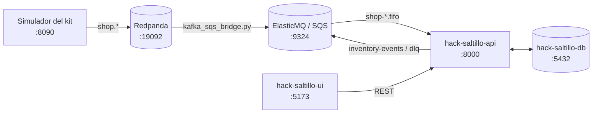

# hack-saltillo-ui

**Roceel · Inventario**: las pantallas del servicio de inventario para el reto *Almacén inteligente para
taller* (HackITS 2026). Muestra existencias, faltantes y sugerencias de compra para el almacén, el avance de
material de cada orden de trabajo, y una pantalla de piso para el celular que escanea etiquetas Code 128 para
retirar, transferir o contar piezas.

- **Stack:** React 19, TypeScript, Vite 8, React Router 7 e íconos `lucide-react`.
- **Datos:** la API de [`hack-saltillo-api`](https://github.com/AgustinReyesC/hack-saltillo-api) por REST, o
  datos de prueba (mocks) para trabajar sin backend.
- **En AWS:** sitio estático en S3 servido por CloudFront, que además reenvía `/api/*` a la API.

## Contenido

1. [El sistema completo](#el-sistema-completo)
2. [Pantallas](#pantallas)
3. [Correr en local](#correr-en-local)
4. [Conectar con la API local](#conectar-con-la-api-local)
5. [Probar en el celular](#probar-en-el-celular)
6. [Variables de entorno](#variables-de-entorno)
7. [Estructura](#estructura)
8. [Despliegue en AWS](#despliegue-en-aws)
9. [Documentación del reto](#documentación-del-reto)

## El sistema completo

| Repo | Qué hace | En local |
|---|---|---|
| [`hack-saltillo-db`](https://github.com/AgustinReyesC/hack-saltillo-db) | PostgreSQL 16: esquema, migraciones (Liquibase) y catálogo semilla. | `localhost:5432` |
| [`hack-saltillo-broker`](https://github.com/AgustinReyesC/hack-saltillo-broker) | Colas SQS FIFO: Terraform para AWS y ElasticMQ para local. | `localhost:9324` |
| [`hack-saltillo-api`](https://github.com/AgustinReyesC/hack-saltillo-api) | Servicio de inventario (NestJS): consume las colas, lleva el libro mayor, publica `stock.*` y expone REST y WebSocket. | `localhost:8000` (HTTP), `:8443` (HTTPS) |
| **`hack-saltillo-ui`** (este) | Pantallas: dashboard, piso con escaneo, órdenes y resolución. | `localhost:5173` |
| [`hack-saltillo-events`](https://github.com/AgustinReyesC/hack-saltillo-events) | Prototipo del agente de IA (Gemini). Aún no se conecta a la API. | proceso de consola |
| `hackathon-inventario-kit` | Kit del reto (no es repo del equipo): Redpanda, simulador, contrato y pruebas de contrato. | `:19092` Kafka, `:8080` consola, `:8090` simulador |



La UI solo habla con la API. Para ver datos reales, la API tiene que estar corriendo con su base y sus colas;
el orden completo está en el
[README de la API](https://github.com/AgustinReyesC/hack-saltillo-api#levantar-todo-el-sistema-en-local).

## Pantallas

| Ruta | Pantalla | Qué hace | Rutas de la API |
|---|---|---|---|
| `/` | **Dashboard** | Existencias por pieza y ubicación, faltantes abiertos y sugerencias de compra. Desde cualquier fila se abre el kardex de la pieza. | `GET /parts`, `GET /parts/{id}/availability`, `GET /shortages`, `GET /reorder-suggestions`, `GET /parts/{id}/ledger` |
| `/piso` | **Piso** (pensada para el celular) | Escanear una ubicación (`U-###`) y una pieza (su `sku`), en cualquier orden, con la cámara o a mano; luego **retirar** contra una orden, **transferir** a otra ubicación o **contar**. | `GET /locations`, `GET /parts?sku=`, `GET /parts/{id}/availability`, `POST /issues`, `POST /transfers`, `POST /counts` |
| `/ordenes`, `/ordenes/:code` | **Órdenes de trabajo** | Busca por código (`R061026012`) y muestra, por pieza, lo reservado, entregado y faltante. El código va en la URL, así que se puede compartir o abrir desde una alerta. | `GET /work-orders/{code}/materials` |
| `/resolucion` | **Resolución** | Compras cuyo número de parte no coincidió con el catálogo; se relacionan a mano con una pieza. | `GET /unmatched-receipts`, `POST /unmatched-receipts/{id}/resolve` |
| todas | **Campana de alertas** | Faltantes abiertos y recepciones sin relacionar. Se calculan del estado actual del servidor: desaparecen solas cuando se resuelven. | `GET /shortages`, `GET /unmatched-receipts`, `GET /events` |
| todas | **Chat** con el asistente | Botón flotante para preguntarle al agente. | `POST {VITE_CHAT_URL}/chat` |

Notas de comportamiento:

- **Escaneo:** usa la API nativa `BarcodeDetector` del navegador (Chrome, Edge y Android) con la cámara trasera
  y formato Code 128. Donde no existe (Safari / iPhone) la pantalla ofrece captura manual. La cámara solo abre en
  `https://` o en `localhost`.
- **Tiempo real:** la UI consulta `GET /events?topic=inventory.events&limit=50` cada 5 s y refresca lo que
  cambió. Todavía no usa el WebSocket de la API.
- **Chat:** con mocks responde un texto fijo. Contra la API real manda `POST {VITE_CHAT_URL}/chat` con
  `{"message"}` y espera `{"answer"}`; hoy ningún repo implementa esa ruta, así que el chat muestra un error.
- **Etiquetas `P-<part_id>`** (piezas sin `sku`): la pantalla de piso busca por `sku` con `GET /parts?sku=`, que
  no las reconoce. Si un `sku` es de varias piezas, toma la primera. La API ya resuelve ambos casos en
  `GET /scan?code=`.

## Correr en local

Requisitos: Node.js 20.19+ o 22.12+ (lo que pide Vite 8; el deploy usa Node 22) y npm.

```bash
npm install
npm run dev
```

Abre http://localhost:5173. Por defecto la UI usa **mocks** (`VITE_USE_MOCKS=true` en `.env`): funciona sin
API, con datos de prueba, y las operaciones de piso generan eventos simulados para la campana.

| Script | Qué hace |
|---|---|
| `npm run dev` | Servidor de desarrollo de Vite con recarga en caliente (`:5173`). |
| `npm run build` | Revisa tipos (`tsc -b`) y genera `dist/`. Usa `.env.production` encima de `.env`. |
| `npm run preview` | Sirve `dist/` para revisar el build (`:4173`). |
| `npm run lint` | ESLint. |

## Conectar con la API local

1. Levanta la API y lo que necesita (base, ElasticMQ, puente y simulador), siguiendo el
   [README de la API](https://github.com/AgustinReyesC/hack-saltillo-api#levantar-todo-el-sistema-en-local).
   Comprueba que responde:

   ```bash
   curl http://localhost:8000/health
   ```

2. Crea `.env.local` en la raíz de este repo. Vite lo carga encima de `.env` y Git lo ignora (`*.local`):

   ```dotenv
   VITE_USE_MOCKS=false
   VITE_API_URL=http://localhost:8000
   VITE_CHAT_URL=http://localhost:8000
   ```

3. Reinicia `npm run dev`: Vite solo lee las variables al arrancar.

En local la API acepta CORS desde `localhost` y desde las IP de la red local en cualquier puerto, así que no hay
que configurar nada del lado de la API.

## Probar en el celular

El celular y la laptop deben estar en la misma red Wi-Fi.

1. Arranca Vite expuesto en la red local. Imprime la URL `Network: http://<ip-de-la-laptop>:5173/`:

   ```bash
   npm run dev -- --host
   ```

2. En `.env.local`, apunta a la API por la IP de la laptop (`localhost` en el celular es el propio celular):

   ```dotenv
   VITE_USE_MOCKS=false
   VITE_API_URL=http://<ip-de-la-laptop>:8000
   ```

3. **Cámara.** El navegador solo abre la cámara en una página segura, y `http://<ip>:5173` no lo es. Opciones:
   - En Chrome para Android, agrega `http://<ip-de-la-laptop>:5173` en
     `chrome://flags/#unsafely-treat-insecure-origin-as-secure` y reinicia Chrome.
   - Captura manual: la pantalla de piso acepta el código tecleado.
   - Servir la UI por HTTPS. Este repo no lo trae configurado: habría que agregar `server.https` en
     `vite.config.ts` (por ejemplo con el certificado de mkcert que genera la API) y apuntar `VITE_API_URL` a
     `https://<ip-de-la-laptop>:8443`, porque una página HTTPS no puede llamar a `http://`.
   - La versión desplegada en CloudFront ya es HTTPS.

4. Abre el puerto 5173 (y el 8000) en el firewall de la laptop si el celular no llega.

Para practicar el escaneo, el kit trae las etiquetas de la demo en `labels/etiquetas-demo.pdf`; se pueden escanear
desde la pantalla de la laptop.

## Variables de entorno

| Variable | `.env` (local) | `.env.production` (CloudFront) | Qué es |
|---|---|---|---|
| `VITE_USE_MOCKS` | `true` | `false` | `false` = API real. Cualquier otro valor = mocks. |
| `VITE_API_URL` | `http://localhost:8000` | `/api` | Base de la API de inventario. |
| `VITE_CHAT_URL` | `http://localhost:8100` | `/api` | Base del servicio de chat; la UI llama a `{VITE_CHAT_URL}/chat`. |

`.env` y `.env.production` se versionan y no llevan secretos. Para cambios locales usa `.env.local`.

## Estructura

```text
src/
  main.tsx, App.tsx         Router y tabla de rutas
  layouts/AppLayout.tsx     Sidebar + campana + vista activa + chat flotante
  views/                    Dashboard, Piso, Órdenes, Resolución
  components/
    containers/             Componentes con datos (chat, kardex, notificaciones, sidebar)
    presentational/         Componentes visuales (tablas, escáner, modales, formularios de piso)
  context/                  EventsContext (una sola suscripción a eventos) y WarehouseContext (datos compartidos)
  hooks/                    useBarcodeScanner, useFloorFlow, useStock, useWorkOrder, useAlerts, useChat
  services/
    config.ts               Interruptor mocks ↔ API real
    inventory/              httpService (único lugar que habla HTTP) y mockService
    events/                 Eventos: mocks o GET /events cada 5 s
    chatApi.ts              POST {VITE_CHAT_URL}/chat
  types/, utils/
public/assets/              Logo y banner
terraform/                  S3, CloudFront y rol de despliegue
docs/                       Documentación del reto y resultados de pruebas
```

Para cambiar de backend solo se toca `src/services/`: el resto de la app importa `inventoryService` y
`eventsService` y no sabe si son mocks o HTTP.

## Despliegue en AWS

`terraform/` crea:

- Un bucket S3 privado para el sitio y otro para el state de Terraform (versionado y cifrado).
- Una distribución de **CloudFront** (HTTPS) con dos orígenes:
  - **S3** para la SPA. Una CloudFront Function manda a `index.html` cualquier ruta sin extensión (`/piso`,
    `/ordenes/...`).
  - **El ALB de la API** para `/api/*`, sin caché y con todos los métodos. Otra función quita el prefijo
    (`/api/parts` → `/parts`). El ALB solo escucha HTTP; CloudFront le da HTTPS a la UI y a la API, que quedan en
    el mismo origen (sin CORS ni contenido mixto).
- Un rol IAM para GitHub Actions por OIDC, con permiso para subir al bucket e invalidar la distribución.

| Variable de Terraform | Valor por defecto | Qué es |
|---|---|---|
| `aws_region` | `us-east-1` | Región de los buckets. |
| `api_origin_domain` | DNS del ALB de la API | Output `api_url` de `hack-saltillo-api/infra`, sin `http://`. |
| `github_repository` | `AgustinReyesC/hack-saltillo-ui` | Repo autorizado a asumir el rol. |
| `name_prefix` | `hack-saltillo-ui` | Prefijo de las CloudFront Functions. |

### Bootstrap inicial

Requisitos: AWS CLI con permisos para crear buckets, CloudFront e IAM; Terraform 1.10 o posterior; `gh`
autenticado. La cuenta debe tener el proveedor OIDC `token.actions.githubusercontent.com` con audiencia
`sts.amazonaws.com` (lo crean los bootstraps de la API o del broker).

Desde la raíz del repositorio, crea el bucket del state y configura el backend:

```sh
export AWS_REGION=us-east-1
export TF_BUCKET_NAME="hack-saltillo-ui-$(aws sts get-caller-identity --query Account --output text)-${AWS_REGION}-tfstate"

aws s3api create-bucket --bucket "$TF_BUCKET_NAME" --region "$AWS_REGION"
terraform -chdir=terraform init -input=false \
  -backend-config="bucket=$TF_BUCKET_NAME" \
  -backend-config="key=hack-saltillo-ui/terraform.tfstate" \
  -backend-config="region=$AWS_REGION" \
  -backend-config="encrypt=true" \
  -backend-config="use_lockfile=true"
terraform -chdir=terraform import aws_s3_bucket.tfstate "$TF_BUCKET_NAME"
terraform -chdir=terraform plan -out=tfplan
terraform -chdir=terraform apply tfplan
```

Guarda los outputs del despliegue como secrets del repositorio:

```sh
gh secret set role_arn --body "$(terraform -chdir=terraform output -raw role_arn)"
gh secret set tf_bucket_name --body "$(terraform -chdir=terraform output -raw tf_bucket_name)"
```

La URL pública es el output `cloudfront_url`. Ese dominio va en la variable `CORS_ORIGIN` de la API.

### Publicar

El workflow `.github/workflows/deploy.yml` (**Deploy to AWS**) se lanza **a mano**, desde la pestaña Actions o
con:

```sh
gh workflow run deploy.yml
```

Instala con Node 22, corre `npm run build`, sube `dist/` al bucket con `aws s3 sync --delete` e invalida la caché
de CloudFront. La región está fija en `us-east-1`. Los cambios de infraestructura (`terraform apply`) se aplican a
mano; el workflow solo lee los outputs.

## Documentación del reto

| Archivo | Qué es |
|---|---|
| [`docs/DECISIONES.md`](docs/DECISIONES.md) | Documento de decisiones: compras ↔ catálogo, kits, reservas dobles e idempotencia. |
| [`docs/RESULTADOS-PRUEBAS.md`](docs/RESULTADOS-PRUEBAS.md) | Resultados de las pruebas del kit contra la API en local (50 / 50) y cómo reproducirlas. |
| [`docs/DOCUMENTACION-COMPLETA.md`](docs/DOCUMENTACION-COMPLETA.md) | Documento técnico del reto, contrato, pruebas y dataset en un solo archivo. |
| [`docs/Reto Hackathon-Almacen Inteligente-Documento tecnico.pdf`](docs/Reto%20Hackathon-Almacen%20Inteligente-Documento%20tecnico.pdf) | Documento técnico original del reto. |
