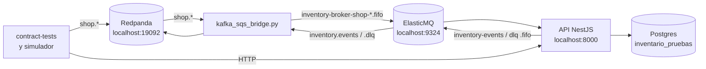

# Resultados de las pruebas locales del kit

*10 oct 2026 · API `hack-saltillo-api@ffc566d` · DB `hack-saltillo-db@a5cb6b8` · broker `hack-saltillo-broker@14800ba`*

Corrimos, sin tocar el código, todas las pruebas que trae `hackathon-inventario-kit` contra la API
de inventario levantada en local. Pasaron todas.

## 1. Resumen

| Prueba | Resultado |
|---|---|
| Pruebas de contrato (`contract-tests/run_tests.py`), 4 corridas | **50.0 / 50** en las 4 (14/14 escenarios), sin eventos fuera de contrato |
| Reconstrucción del jurado (`snapshot` → borrar la base → releer → `compare`) | **✔ mismo saldo en 256 piezas**; los archivos de saldo de antes y después son idénticos byte a byte |
| `tools/validate_events.py` sobre el dataset de entrada | 1,742 eventos, 0 errores |
| `tools/validate_events.py` sobre **todas** las salidas de la API (`inventory.events`) | 2,270 eventos, 0 errores, 0 `event_id` repetidos, 0 llaves de mensaje distintas a `event.key` |
| `inventory.dlq` | 0 eventos (ningún evento terminó en la DLQ) |
| Idempotencia a escala: el simulador reenvía los 1,742 eventos del dataset | 0 movimientos nuevos, 0 salidas nuevas, saldo idéntico |
| Pruebas unitarias de la API (`vitest run`, complementarias) | 43 / 43 |

Puntaje automático estimado: **50 de 50** (25 de libro mayor y 25 de integración con el taller).
Ojo: depende de que el día de la evaluación esté corriendo el puente Kafka ↔ SQS (ver §5.1).

## 2. Cómo se armó el entorno

Las pruebas del kit publican y leen en **Kafka** (Redpanda). La API solo habla **SQS**. Para
conectarlas sin modificar ninguna de las dos, agregamos un puente de prueba,
[`kafka_sqs_bridge.py`](kafka_sqs_bridge.py). Todo corrió en local; no se usó ningún recurso de AWS.



| Componente | Dónde y cómo |
|---|---|
| Redpanda v24.2.7 y su consola | `docker compose up -d redpanda console` del kit (WSL2, Docker 29.9). Tópicos con 3 particiones, igual que el simulador |
| ElasticMQ 1.7.1 (emulador de SQS) | `docker compose up -d elasticmq` de `hack-saltillo-broker` |
| Postgres 16 y Liquibase 4.29 | Contenedor `saltillo-db` de `hack-saltillo-db`. Usamos una base **aparte**, `inventario_pruebas` (37 changesets, contexto `seed`). La base `inventario` del equipo no se tocó |
| API | `npm run build` y `node --env-file=pruebas-locales/api.env.pruebas dist/main.js` (Node 25.9). Solo HTTP en el 8000 |
| Puente | Python 3.14, confluent-kafka 2.16, boto3. Crea las 7 colas FIFO con los atributos de `sqs.tf` |
| Pruebas de contrato | Corridas 1 y 3 en Windows (Python 3.14, confluent-kafka 2.16). Corridas 2 y 4 con el **comando oficial** `docker compose run --rm contract-tests` (imagen `python:3.12-slim`, confluent-kafka 2.6.1) |

Decisiones del puente que importan para leer los resultados:

- Cada registro de Kafka se convierte en **exactamente un** mensaje SQS. Para eso usamos como
  `MessageDeduplicationId` la corrida del puente más el tópico, la partición y el offset, y no
  el `event_id`. Así los reenvíos de `idempotencia` y del simulador sí llegan a la API. Si hubiéramos
  usado el `event_id`, SQS los habría descartado antes. Por eso la idempotencia que se midió es la de
  la API.
- `MessageGroupId` es la llave del evento, así que se conserva el orden por llave.
- El cuerpo es `{"topic", "event"}`, el mismo formato del simulador en modo SQS.
- Envía y confirma un mensaje a la vez (unos 20 mensajes por segundo). Es lento a propósito: así no
  se pierden mensajes ni se altera el orden.

## 3. Resultados de las pruebas de contrato

| Corrida | Condiciones | Resultado | Log |
|---|---|---|---|
| 1 | Base nueva, sin dataset | 50.0 / 50 | [`contract-tests-corrida-1.log`](logs/contract-tests-corrida-1.log) |
| 2 | Comando oficial en Docker (Python 3.12) | 50.0 / 50 | [`contract-tests-corrida-2-docker-oficial.log`](logs/contract-tests-corrida-2-docker-oficial.log) |
| 3 | Con las 6 semanas del dataset ya cargadas | 50.0 / 50 | [`contract-tests-corrida-3-con-dataset.log`](logs/contract-tests-corrida-3-con-dataset.log) |
| 4 | Comando oficial, después de la reconstrucción y del reenvío del dataset | 50.0 / 50 | [`contract-tests-corrida-4-post-reconstruccion.log`](logs/contract-tests-corrida-4-post-reconstruccion.log) |

Detalle de la corrida 4, la oficial:

| Libro mayor (25) | s | Integración con el taller (25) | s |
|---|---|---|---|
| ✔ `recepcion_basica` | 2.5 | ✔ `reserva_faltante_compra_y_salida` | 6.0 |
| ✔ `idempotencia` | 5.4 | ✔ `lineas_que_no_reservan` | 10.2 |
| ✔ `salida_sin_negativos` | 3.7 | ✔ `compra_para_cliente` | 5.4 |
| ✔ `transferencia_y_conteo` | 6.0 | ✔ `recepcion_sin_relacionar` | 4.3 |
| ✔ `kardex` | 6.1 | ✔ `necesidad_se_reemplaza` | 6.4 |
| | | ✔ `rechazo_y_anulacion` | 6.0 |
| | | ✔ `baja_de_orden` | 3.3 |
| | | ✔ `desorden` | 5.4 |
| | | ✔ `concurrencia` | 7.0 |

Ningún escenario se acercó al límite de 20 s por resultado. El más lento, `lineas_que_no_reservan`,
tardó unos 10 s; la mayor parte son esperas fijas de la prueba (`--settle`).

## 4. Validaciones adicionales

### 4.1 Dataset completo (6 semanas)

Reprodujimos el simulador del kit con `SPEED=0`: 1,742 entregas, 65 de ellas repetidas. Todo pasó
por el puente y la API terminó con 0 eventos pendientes, 0 sin publicar y 0 en la DLQ.

Para revisar cómo se relacionan las compras con el catálogo, aplicamos por separado la regla mínima
del contrato al dataset (`trim` + minúsculas):

| | Regla mínima, análisis independiente | API |
|---|---|---|
| Compras `restock` únicas | 839 | — |
| Relacionadas con una pieza | 541 | 541 |
| A revisión manual (sin coincidencia o `sku` compartido) | 298 (261 + 37) | 298 |

La API coincide exactamente con la regla mínima del contrato.

### 4.2 Reconstrucción (regla 23)

Seguimos el procedimiento del jurado (`contract-tests/README.md`):

1. `run_tests.py snapshot`: 256 piezas del dataset, 160 con existencia y 1,915 unidades
   ([`saldo-antes.json`](saldo-antes.json)).
2. Detuvimos la API y el puente y borramos y recreamos `inventario_pruebas` con Liquibase.
3. El puente releyó **todos** los tópicos desde el inicio (grupo de consumo nuevo, colas purgadas):
   2,013 mensajes, del dataset y de las pruebas.
4. Arrancamos la API. Leyó `shop.catalog` completo antes que las demás colas, como pide la
   regla 22.
5. `run_tests.py compare`: **✔ mismo saldo en 256 piezas**. Corrimos `compare` dos veces, con las
   colas SQS ya vacías; [`saldo-despues.json`](saldo-despues.json) es idéntico a `saldo-antes.json`.

### 4.3 Idempotencia a escala

Reiniciamos el simulador y volvió a publicar los 1,742 eventos con los mismos `event_id`. El puente
trasladó 1,742 mensajes más, y la API los consumió todos sin cambiar nada:

| | Antes | Después |
|---|---|---|
| `event_inbox` | 1,941 | 1,941 |
| `movement` | 589 | 589 |
| `outbox_event` | 4,258 | 4,258 |
| `compare` contra el snapshot | — | ✔ mismo saldo |

### 4.4 Invariantes sobre los datos reales (base reconstruida)

- Ningún saldo tiene `available` negativo.
- Hay 33 piezas con faltantes abiertos y existencia disponible. Sus 79 faltantes son **todos** de
  cantidad desconocida (`missing_quantity: null`), y la regla 5 dice que esos no reservan. No queda
  ningún faltante con cantidad conocida abierto mientras haya existencia de su pieza.
- En la reconstrucción las recepciones resolvieron 571 faltantes del dataset (`stock.shortage_resolved`).

## 5. Hallazgos y riesgos

### 5.1 El jurado prueba por Kafka y la API solo habla SQS (riesgo alto)

El jurado corre `docker compose run --rm contract-tests`, que publica y lee **solo en Redpanda**. Sin
un puente, la API no recibe nada y las pruebas de contrato dan **0 de 50**. El README de
`hack-saltillo-broker` ya lo advierte ("El consumidor de inventario no se ha migrado todavía a SQS").

Qué hacer:

- El día de la evaluación, correr `kafka_sqs_bridge.py` (o algo equivalente) junto a la API,
  contra el Redpanda del kit.
- Incluirlo en el README de entrega, que debe levantar todo con un comando sobre el kit.

La API desplegada en ECS lee las colas reales de AWS. Para evaluarla con el kit, el puente tendría
que apuntar a esas colas, y entonces competiría por los mensajes con cualquier otro consumidor. Por
eso estas pruebas se hicieron 100 % en local, con ElasticMQ.

### 5.2 La reconstrucción tiene que releer desde Kafka

SQS borra cada mensaje al consumirlo y no permite releer desde el inicio. Para la reconstrucción del
jurado, la relectura sale de Kafka:

```
python -u kafka_sqs_bridge.py --group <grupo-nuevo> --purge
```

Así lo probamos en §4.2, y funcionó.

### 5.3 La relación de compras se queda en la regla mínima (mejora opcional)

De las 298 compras que van a revisión manual, **104** coincidirían con una sola pieza si se ignoran
también los espacios internos y la puntuación. Ejemplos: `"  INSERTO - 001 "` → `INSERTO-001`,
`MN70288` → `MN70-2-88` y `CRPARED10MM` → `CR-PARED-10MM`. Otras 151 no se parecen a ningún `sku`
(números de proveedor) y 37 son `sku` compartidos por dos piezas.

El contrato invita a usar "reglas de relación más listas", explicadas en el documento de
decisiones, y ese documento vale 15 puntos. Si se adopta la regla, hay que relacionar
automáticamente solo cuando haya **un único** candidato.

### 5.4 Las reservas dependen del ritmo de llegada (esperado)

En la primera carga, con `SPEED=0` y la API ya corriendo, ninguna recepción del dataset resolvió
faltantes: las 6 `shortage_resolved` de esa pasada vienen de las pruebas. En la reconstrucción hubo
571. En las dos pasadas `on_hand` salió idéntico. El contrato (regla 23) ya dice que las reservas
dependen del intercalado entre tópicos, así que esto no es un error.

Para la demo conviene usar el ritmo normal del simulador (`SPEED=3600`), con el que las compras
llegan después de las inspecciones.

## 6. Variables de entorno (no se modificó ningún archivo)

No cambiamos `.env`, `.env.local` ni `.env.example`. La API se arrancó con un archivo aparte,
[`api.env.pruebas`](api.env.pruebas). Para correr la API en local con `npm run start`, `.env.local`
necesita dos cambios:

1. **HTTPS**: `HTTPS_KEY_PATH=certs/local-key.pem` apunta a un archivo que no existe (`certs/` está
   vacío), y con eso la API **no arranca**. Lo verificamos con el mismo `loadServerConfig` de la
   API: `No se pudo leer HTTPS_KEY_PATH=certs/local-key.pem: ENOENT`. Hay que generar el
   certificado con `npm run cert:local -- <ip-de-la-laptop>`, o dejar vacías
   `HTTPS_KEY_PATH` y `HTTPS_CERT_PATH` (solo HTTP).
2. **SQS**: las variables de colas están vacías, así que la API no consume ni publica. Para
   ElasticMQ en local:

```
AWS_REGION=us-west-2
AWS_ACCESS_KEY_ID=test
AWS_SECRET_ACCESS_KEY=test
SQS_ENDPOINT_URL=http://localhost:9324
SQS_SHOP_CATALOG_URL=http://localhost:9324/000000000000/inventory-broker-shop-catalog.fifo
SQS_SHOP_WORK_ORDERS_URL=http://localhost:9324/000000000000/inventory-broker-shop-work-orders.fifo
SQS_SHOP_INSPECTIONS_URL=http://localhost:9324/000000000000/inventory-broker-shop-inspections.fifo
SQS_SHOP_PURCHASING_URL=http://localhost:9324/000000000000/inventory-broker-shop-purchasing.fifo
SQS_NOTIFICATIONS_URL=http://localhost:9324/000000000000/inventory-broker-notifications.fifo
SQS_INVENTORY_EVENTS_URL=http://localhost:9324/000000000000/inventory-broker-inventory-events.fifo
SQS_INVENTORY_DLQ_URL=http://localhost:9324/000000000000/inventory-broker-inventory-dlq.fifo
```

Las pruebas e2e de la API (`npm run test:e2e`) **no se corrieron**. Leen `.env.local` directamente
y escriben (y luego borran) datos de prueba en la base `inventario` del equipo, que decidimos no
tocar.

## 7. Cómo reproducir

Desde WSL, con Docker:

```bash
# Infraestructura
cd hack-saltillo-db && docker exec saltillo-db psql -U inventario -d inventario -c "CREATE DATABASE inventario_pruebas"
docker compose run --rm -e LIQUIBASE_COMMAND_URL=jdbc:postgresql://postgres:5432/inventario_pruebas liquibase
cd ../hackathon-inventario-kit && docker compose up -d redpanda console
docker exec hackathon-inventario-kit-redpanda-1 rpk topic create shop.catalog shop.work_orders shop.inspections shop.purchasing inventory.events inventory.dlq -p 3
cd ../hack-saltillo-broker && docker compose up -d elasticmq
```

> En WSL2, la VM se apaga cuando no queda ninguna sesión abierta y los puertos dejan de verse desde
> Windows. Mantengan una terminal de WSL abierta mientras prueban.

En Windows (o cualquier shell con Python y Node). Cada paso va en su propia terminal, desde la raíz
del workspace y con el venv activado (`.venv-pruebas/Scripts/activate`):

```bash
python -m venv .venv-pruebas && .venv-pruebas/Scripts/pip install confluent-kafka jsonschema boto3
# 1. Puente (crea las colas)
cd hackathon-inventario-kit/pruebas-locales && python -u kafka_sqs_bridge.py --log logs/bridge.log
# 2. API
cd hack-saltillo-api && npm run build && node --env-file=../hackathon-inventario-kit/pruebas-locales/api.env.pruebas dist/main.js
# 3. Pruebas de contrato
cd hackathon-inventario-kit && python contract-tests/run_tests.py --broker localhost:19092 --api http://localhost:8000
```

Comando oficial desde WSL. Dentro de un contenedor, `host.docker.internal` no llega a Windows: se
usa la IP del host, la puerta de enlace de WSL.

```bash
docker compose run --rm contract-tests --api "http://$(ip route show default | awk '{print $3}'):8000"
```

Dataset y reconstrucción:

```bash
SPEED=0 docker compose up -d simulator                       # reproduce el dataset
python contract-tests/run_tests.py snapshot --out pruebas-locales/saldo-antes.json
# detener la API y el puente, recrear inventario_pruebas con Liquibase, y luego:
python -u pruebas-locales/kafka_sqs_bridge.py --group sqs-bridge-reconstruccion --purge
# cuando el lag del grupo llegue a 0, arrancar la API y:
python contract-tests/run_tests.py compare --out pruebas-locales/saldo-antes.json
```

Salidas: `python pruebas-locales/dump_topic.py inventory.events salidas.jsonl` y luego
`python tools/validate_events.py salidas.jsonl`.

## 8. Archivos de esta carpeta

| Archivo | Qué es |
|---|---|
| `kafka_sqs_bridge.py` | Puente Kafka ↔ SQS (herramienta de prueba; no modifica nada) |
| `dump_topic.py` | Vuelca un tópico a JSONL y revisa las llaves de mensaje |
| `api.env.pruebas` | Entorno local de la API usado en las pruebas |
| `saldo-antes.json`, `saldo-despues.json` | Snapshots de la reconstrucción |
| `logs/contract-tests-corrida-*.log` | Salida de las 4 corridas de contrato |
| `logs/reconstruccion-*.log`, `logs/idempotencia-dataset-duplicado-compare.log` | Reconstrucción y reenvío del dataset |
| `logs/validate-*.log`, `logs/dump-inventory-events.log` | Validación de entradas y salidas contra el contrato |
| `logs/inventory-events.jsonl`, `logs/inventory-dlq.jsonl` | Volcado de las salidas de la primera pasada (la DLQ vacía) |
| `logs/bridge*.log`, `logs/api*.log` | Logs del puente (un renglón por mensaje) y de la API |
| `logs/api-unit-tests.log` | Pruebas unitarias de la API |
